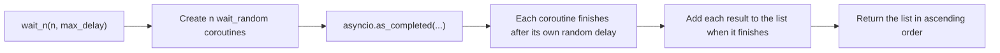

# Holberton School - Web Back End

Back-end projects from Holberton School, written in Python 3.
The first projects are about **asynchronous programming** with `asyncio`.

## Projects

| Folder | What is inside |
| --- | --- |
| [python_async_function](python_async_function/) | Basic `async` / `await`, running coroutines together, measuring runtime, and creating tasks |
| [python_async_comprehension](python_async_comprehension/) | Async generators, async comprehensions, and measuring runtime |

### python_async_function

| File | Topic |
| --- | --- |
| `0-basic_async_syntax.py` | A basic coroutine (`wait_random`) |
| `1-concurrent_coroutines.py` | Run many coroutines together (`wait_n`) |
| `2-measure_runtime.py` | Measure the runtime of the concurrent code |
| `3-tasks.py`, `4-tasks.py` | Create `asyncio` tasks |

### python_async_comprehension

| File | Topic |
| --- | --- |
| `0-async_generator.py` | An async generator |
| `1-async_comprehension.py` | Async comprehension |
| `2-measure_runtime.py` | Run several comprehensions in parallel and measure the time |

## How `wait_n` works

`wait_n` starts `n` coroutines at the same time. Each one waits for a random delay.
The results are saved in the order they finish, so the final list is already sorted from the smallest delay to the biggest.



## Example

```python
#!/usr/bin/env python3
import asyncio

wait_n = __import__('1-concurrent_coroutines').wait_n

print(asyncio.run(wait_n(5, 5)))
```

## Requirements

- Python 3
- Type annotations on functions
- Files start with `#!/usr/bin/env python3` and are executable

## Author

Arif Almusharafi - [GitHub](https://github.com/arif-almusharafi)
